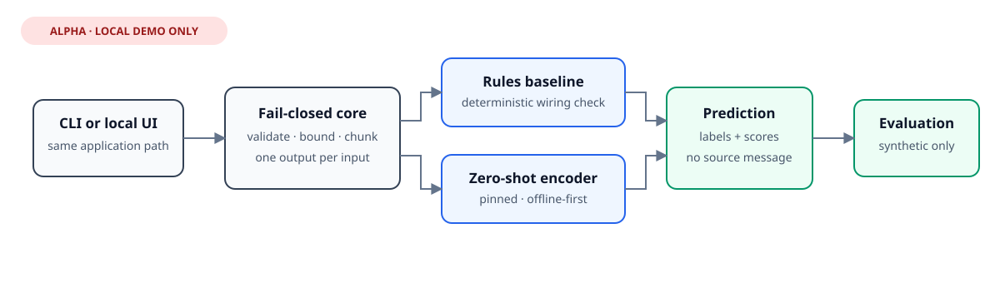

# Log Classification Pipeline

## Project status

This repository contains the alpha batch-processing foundation for a future log
classification pipeline. It is **not production-ready**. The planned first
release is `v0.1.0-alpha.1`, titled **Fail-closed batch-processing foundation**.
The project is available under the [MIT License](LICENSE).

All examples and test records are synthetic. This repository includes no model,
checkpoint, tokenizer, dataset, production log, or operational configuration.
An optional, offline-first zero-shot adapter is included, but model artifacts
remain outside the repository.

## Problem

Batch classifiers can create dangerous ambiguity when they skip malformed
records, publish partial output, or report success after processing only part of
an input. Downstream automation may then treat incomplete results as complete.

This foundation establishes a strict boundary before a model adapter is called.
It validates the entire input, enforces a one-input/one-output contract, and
publishes output only after every result has passed validation.

## Design goals

- Fail closed on malformed input or predictor contract violations.
- Never silently publish a partial batch.
- Preserve the exact input identity with a SHA-256 digest.
- Avoid overwriting existing output unless explicitly requested.
- Make post-publication durability failures distinguishable from failures that
  occur before a destination becomes visible.
- Keep the core independent from any model framework.
- Make the model adapter and local UI optional, lazy-loaded extras.
- Emit privacy-minimal classifications without echoing input messages.

## Architecture

The package is organized into strict JSONL parsing, input/output contracts,
batch orchestration, and atomic publication helpers. See
[docs/architecture.md](docs/architecture.md) for component boundaries and
failure semantics.

The CLI and local UI call the same fail-closed application services.

An optional local authenticated workspace now adds an offline consult-and-export
flow with separate admin, analyst, and viewer roles. It uses a private SQLite
database, retains raw source bytes only when explicitly requested from the CLI,
and applies separate retention periods to raw data, results, and audit events.
The optional web adapter adds a localhost-only browser interface and HTTP API;
its web surface validates uploads before returning `202 Accepted`, runs them in
a bounded single-worker queue, exposes progress and cancellation, and never
stores raw uploads in SQLite. See the
[local workspace guide](docs/local-workspace.md) and
[web workspace guide](docs/web-workspace.md). This is not a remotely exposed
multi-tenant service.

## Fail-closed batch contract

Every non-blank input line must be a UTF-8 JSON object with a non-blank
message string. Duplicate object keys, non-finite numbers, malformed JSON,
invalid optional field types, and scalar top-level values are rejected.

The complete input is parsed and validated before the predictor is called. The
predictor must then return exactly one mapping for every input record. If any
chunk fails or returns the wrong number of results, output publication does not
start. Predictor iterables are consumed only through the first excess result,
so cardinality checks do not materialize unbounded overproduction.

Unknown fields are preserved and passed to the predictor. The caller remains
responsible for data minimization before invoking the library.

## Resource bounds

`read_jsonl` and `process_batch` accept positive `max_input_bytes` and
`max_records` limits. The byte limit is enforced while reading at most one
byte beyond the boundary. The record limit counts non-blank JSONL lines and
fails on the first excess line. Either failure occurs before predictor
invocation.

Limits default to `None` to avoid inventing an operational policy for callers
in this alpha. Applications processing untrusted data should set both values;
the package remains an in-memory batch foundation rather than a streaming
parser.

## Atomic output publication

Output is encoded into a temporary file in the destination directory. The file
is flushed and synced before publication. Output permissions default to
`0o600` and can be changed explicitly with `output_mode`. By default, an
existing destination is not replaced. The directory is synced after the
destination becomes visible.

Failures before publication attempt to remove the temporary file. Failures
after the destination becomes visible raise a dedicated committed-publication
exception, so callers are not told that an already visible output was rolled back.

## Installation

Python 3.12 or newer is required. The core has no third-party runtime
dependencies. Model and UI dependencies are optional.

    python3 -m venv .venv
    .venv/bin/python -m pip install --no-deps .

For the local rules-based wiring demo:

    PYTHONPATH=src python3 -m log_classification_pipeline.cli evaluate tests/fixtures/synthetic-evaluation.jsonl

For the local UI:

    .venv/bin/python -m pip install '.[ui]'
    .venv/bin/log-classify ui

For the authenticated local workspace:

    .venv/bin/log-classify workspace init ./state/workspace.sqlite3 sample-org owner
    .venv/bin/log-classify workspace classify \
      ./state/workspace.sqlite3 sample-org owner examples/input-valid.jsonl
    .venv/bin/log-classify workspace jobs \
      ./state/workspace.sqlite3 sample-org owner

Passwords are prompted interactively. The workspace has no default credentials
and does not accept passwords as command-line arguments.

For the authenticated localhost web interface and API:

    .venv/bin/python -m pip install '.[web]'
    .venv/bin/log-classify web ./state/workspace.sqlite3

Then open `http://127.0.0.1:8080/app`. The server binds only to loopback and is
an alpha local workflow, not an Internet-facing deployment. See the
[web workspace guide](docs/web-workspace.md) for roles, API behavior, and
security boundaries. The browser interface can be switched between English,
Italian, French, and Spanish; API and export field names remain stable.
`--queue-capacity` bounds admitted work, including the running job, and
`--worker-batch-size` controls cancellation/progress checkpoints.

For zero-shot inference:

    .venv/bin/python -m pip install '.[ml]'
    .venv/bin/log-classify classify input.jsonl output.jsonl --adapter zero-shot \
      --model-source /path/to/local/model \
      --model-id MoritzLaurer/deberta-v3-base-zeroshot-v2.0-c \
      --model-revision bddf8c5411c34ac3565e16e04384fd68b2618dda

Downloads are disabled by default. Pass `--allow-download` only when network
access and the pinned model provenance are acceptable.

For multilingual English, Italian, French, and Spanish input, select the larger
experimental profile explicitly:

    .venv/bin/log-classify evaluate \
      tests/fixtures/synthetic-evaluation-multilingual.jsonl \
      --adapter zero-shot --model-profile multilingual-bge-m3-v1 \
      --allow-download

This can download an approximately 1.14 GB model. Profile resolution, artifact
loading, and the adapter contract are tested. A controlled 4-vCPU run did not
finish the 40-record development fixture within five minutes, so this profile
is not suitable for the synchronous interactive CPU path on the measured host.
Its classification quality has not yet been measured here.

## Synthetic example

Validate the included synthetic examples without invoking a model:

    PYTHONPATH=src python3 examples/validate.py examples/input-valid.jsonl
    PYTHONPATH=src python3 examples/validate.py examples/input-invalid.jsonl

The first command exits with status 0. The second command reports a validation
failure and exits non-zero. It does not create output or call a predictor.

## Experimental model adapter

The default experimental English encoder is
[`MoritzLaurer/deberta-v3-base-zeroshot-v2.0-c`](https://huggingface.co/MoritzLaurer/deberta-v3-base-zeroshot-v2.0-c),
pinned to a full commit revision. It is an NLI encoder used for zero-shot
classification, not a generative LLM. The public taxonomy has ten subsystem
labels and five severity labels. Predictions include labels, scores,
abstention, model/profile provenance, and a deterministic configuration digest;
they do not copy the source message. An opt-in BGE-M3 profile covers the
intended four-language scope without claiming measured accuracy.

See [model selection](docs/model-selection.md) for the rationale and
[synthetic evaluation results](docs/results/2026-08-07-synthetic-evaluation.md)
for the first honest, deliberately small measurement. The separate
[local web security validation](docs/results/2026-08-07-web-security-validation.md)
records the current authentication, upload, packaging, and privacy checks.
The [multilingual smoke baseline](docs/results/2026-08-07-multilingual-smoke-baseline.md)
records the rules adapter's limitations on the balanced development fixture.

## Running tests

    PYTHONDONTWRITEBYTECODE=1 PYTHONPATH=src \
      python3 -m unittest discover -s tests -v

The suite covers strict parsing, aggregate validation errors, predictor count
mismatches, exceptions in later chunks, symlink and path aliases, overwrite
behavior, resource-limit boundaries, Unicode JSONL separators, bounded predictor
output, atomic cleanup, post-publication durability errors, workspace RBAC,
pre-session and session-bound CSRF, bounded uploads, security headers, and
privacy-minimal web exports. Web integration tests require `.[web,test]`.

## Security and privacy

- Every bundled example and fixture is synthetic.
- No real logs, infrastructure identifiers, credentials, datasets, or model
  artifacts belong in this repository.
- Input is treated as untrusted structured data; validation happens before model
  invocation.
- The library does not redact arbitrary user fields. Applications must minimize
  and sanitize data before processing.
- Existing destinations are protected from overwrite by default.
- Security reports should follow [SECURITY.md](SECURITY.md).

## Current limitations

- Both zero-shot profiles are experimental and their scores are not calibrated
  probabilities. The multilingual profile loaded successfully but did not
  complete the 40-record CPU capacity run within five minutes.
- Model artifacts and optional dependencies are not bundled.
- The Gradio UI is an unauthenticated localhost demonstration. The separate web
  workspace is authenticated but remains localhost-only and alpha.
- The authenticated workspace supports one organization per SQLite database.
  Its optional HTTP API and browser interface are not a remotely supported
  service, an SSO integration, or a production multi-tenant isolation boundary.
- The web adapter has no brute-force rate limiter, TLS termination, reverse
  proxy support, account recovery, or server database.
- The web queue is one process-local worker. Bounded raw input bytes exist
  transiently in RAM and a private temporary file during execution, and may
  therefore be exposed to swap, core dumps, or the owning OS account. Jobs are
  not resumed after restart; active states become `failed/interrupted`.
- Workspace database permissions and SQLite secure deletion do not provide
  encryption at rest or guarantee erasure from backups, snapshots, SSDs, or
  copy-on-write storage.
- Input is read and validated in memory. Resource limits are opt-in and no
  default operational profile is claimed.
- Atomicity and durability behavior is designed for local POSIX-like
  filesystems and is not claimed for every network filesystem or operating
  system.
- The predictor is supplied by the caller and runs in-process without isolation.
- The classification taxonomy is versioned, but input schema negotiation is not
  implemented.
- This project has not completed production hardening, load testing, or an
  independent security review.

## Roadmap

1. Define measured operational profiles and evaluate conservative default limits.
2. Calibrate abstention and severity labels on a larger, independently authored
   synthetic evaluation set.
3. Select and benchmark a genuinely multilingual smaller fallback, then measure
   warm/cold CPU behavior; do not assume the English MiniLM candidate satisfies
   the four-language requirement.
4. Add an explicit artifact manifest and cache verification workflow.
5. Review cross-platform publication semantics and document supported
   filesystems.
6. Run the pinned multilingual profile on suitable GPU or asynchronous batch
   infrastructure, then build a larger independently reviewed holdout before
   making accuracy claims.
7. Add rate limits and a deployment threat model before considering any
   non-loopback API or web exposure.
8. Add bounded syslog ingestion with backpressure, source authentication, and a
   separate retention policy; keep it disabled by default.
9. Validate CI, then prepare the planned v0.1.0-alpha.1 release without changing
   the foundation scope.
