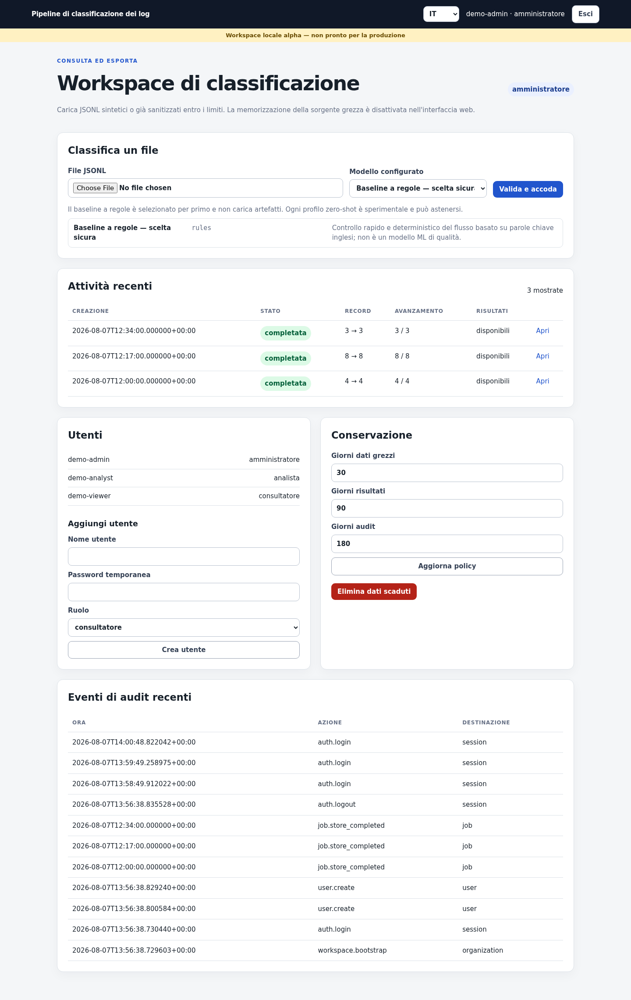
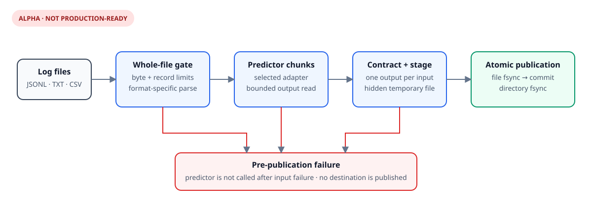

<p align="center">
  
</p>

<h1 align="center">Log Classification Pipeline</h1>

<p align="center">
  Turn local log files into structured, exportable findings through a browser
  dashboard, API, or CLI.
</p>

<p align="center">
  <a href="https://github.com/silirim/log-classification-pipeline/actions/workflows/test.yml"></a>
  <a href="https://github.com/silirim/log-classification-pipeline/releases"></a>
  <a href="LICENSE"></a>
  
  
</p>

<p align="center">
  <a href="#quick-start">Quick start</a> ·
  <a href="https://github.com/silirim/log-classification-pipeline/releases">Downloads</a> ·
  <a href="#project-guide">Documentation</a> ·
  <a href="SECURITY.md">Security</a>
</p>

> [!WARNING]
> This is alpha software, not a production-ready SIEM. It is intended for
> local, bounded analysis and ships no logs, datasets, model weights, or default
> credentials.

<p align="center">
  <a href="docs/assets/dashboard-preview.png">
    
  </a>
  <br>
  <sub>Authenticated local dashboard · synthetic data only</sub>
</p>

| Local by default | Fail closed | Multiple interfaces |
| --- | --- | --- |
| Loopback-only browser app, local SQLite workspace, and offline rules baseline. | The whole input and every prediction must pass validation before a batch is published. | Use the dashboard, automate through the API, or integrate the Python CLI. |

## Quick start

Download **[v0.1.0-alpha.1](https://github.com/silirim/log-classification-pipeline/releases/tag/v0.1.0-alpha.1)** for 64-bit Linux:

| Package | Best for |
| --- | --- |
| **AppImage** | Portable desktop use |
| **`.deb`** | Ubuntu 24.04+ or Debian 13 |
| **`.rpm`** | Fedora 41+ |
| **`.tar.gz`** | Portable or server setup |

DEB and RPM packages add a desktop launcher. On first launch, a guided setup
creates a private workspace, administrator account, and password, then opens
the app locally.

Packages include the web workspace and offline rules baseline. They do **not**
include a model, tokenizer, Transformers, PyTorch, or dataset. See the
[Linux install guide](docs/linux-packages.md) for checksum verification,
AppImage permissions, and optional systemd setup.

## What it handles

| Input | Contract |
| --- | --- |
| JSONL / NDJSON | One object per line with a non-blank `message` field |
| TXT / LOG | One message per non-blank line |
| CSV | One unique column named exactly `message` |

Quoted CSV fields and embedded newlines are supported. Each file is limited to
25 MiB and 25,000 records; the local web queue admits 50 MiB total across active
and queued jobs.

The dashboard is available in English, Italian, French, and Spanish. Local
accounts have separate admin, analyst, and viewer roles. Completed findings can
be consulted and exported without copying the original message into each
prediction record.

## How it works

Malformed input, invalid UTF-8, duplicate JSON keys, inconsistent CSV rows,
predictor failures, and result-count mismatches stop the batch. No partial
destination is published.



## Choose a classification engine

| Profile | Purpose | Included |
| --- | --- | --- |
| `rules` | Deterministic offline baseline and safest first run | Yes |
| English DeBERTa | Experimental zero-shot classification | No |
| Multilingual NLI | Experimental English, Italian, French, and Spanish analysis | No |

Model downloads are disabled by default. Local model directories require a
verified manifest and stay outside the repository. Published evaluations are
development measurements, not accuracy or production claims. Read
[model selection](docs/model-selection.md) and the
[multilingual evaluation](docs/results/2026-08-07-multilingual-model-evaluation.md).

## For developers

Python 3.12+ is required. The smallest local setup uses no downloaded model:

```console
python3 -m venv .venv
.venv/bin/python -m pip install --no-deps .
.venv/bin/log-classify doctor
```

Install the optional authenticated web interface with `.[web]`. Passwords are
prompted interactively and never accepted as command-line arguments. See
[the test guide](tests/README.md) for the development workflow and coverage.

## Project guide

| Read about | Document |
| --- | --- |
| Installers and first launch | [Linux packages](docs/linux-packages.md) |
| Browser app, API, and security boundaries | [Web workspace](docs/web-workspace.md) |
| Accounts, roles, retention, and export | [Local workspace](docs/local-workspace.md) |
| Fail-closed design and atomic publication | [Architecture](docs/architecture.md) |
| Model profiles and artifact verification | [Model selection](docs/model-selection.md) |
| Measured evidence | [Results](docs/results/) |

## Current boundaries

- Local use only: remote deployment is unsupported.
- The SQLite workspace is unencrypted and limited to one organization.
- Inputs are processed in memory; predictors run in-process.
- Queue state and login rate limits reset when the process restarts.
- Zero-shot scores are experimental and not calibrated probabilities.
- Production hardening, load testing, SSO, distributed workers, signed packages,
  and an independent security review remain future work.

All examples and screenshots use synthetic data. Please do not add real logs,
credentials, infrastructure identifiers, model weights, or operational
configuration to this repository.

## License

[MIT](LICENSE) © 2026 Riccardo Melini.
