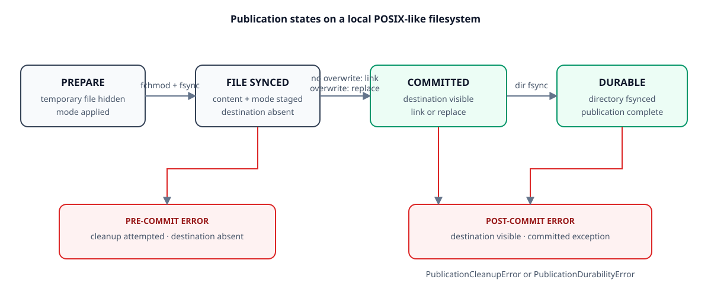

# Architecture

## Scope

The core is a model-independent boundary for synthetic or already-sanitized
JSONL batches. Optional adapters, a CLI, and a localhost-only UI sit outside the
core boundary and reuse the same validation, orchestration, and atomic
publication path.

## Components

| Component | Responsibility | Failure behavior |
|---|---|---|
| jsonl.py | Enforce optional byte/record limits, decode UTF-8, reject invalid JSON constructs, retain valid records, compute input identity | Reject a limit breach or collect validation issues and reject the whole batch |
| contracts.py | Validate stable input fields and predictor output mappings | Return line-specific issues or raise a predictor contract error |
| batch.py | Validate before prediction, chunk records, consume at most one excess output, enforce one output per input | Stop before publication if input or predictor behavior is invalid |
| atomic.py | Encode JSONL, apply permissions, sync a temporary file, publish, sync the directory | Attempt pre-publication temporary cleanup; distinguish committed failures |
| adapters/rules.py | Provide a deterministic wiring baseline for synthetic demos | Abstain when subsystem evidence is absent |
| adapters/zero_shot.py | Lazy-load a pinned NLI encoder, offline by default | Fail before publication on missing artifacts or invalid model output |
| application.py / cli.py | Expose shared local workflows | Return concise errors and non-zero CLI status |
| ui.py | Build an optional localhost Gradio interface | No launch or dependency import until explicitly requested |
| workspace.py | Persist complete classifications with local users, roles, sessions, retention, and audit | Deny before prediction; commit a complete job and its audit event together |
| web/app.py | Provide an optional authenticated loopback API and server-rendered UI | Authenticate, authorize, check CSRF, and enforce request limits before parsing uploads or invoking a predictor |

## Processing sequence

1. Read the input with an optional byte bound and calculate its SHA-256 digest.
2. Decode UTF-8 and parse LF-delimited, non-blank JSONL lines with duplicate-key and
   non-finite-number rejection.
3. Enforce an optional non-blank record-line bound and aggregate input issues.
   If a limit or validation issue occurs, reject the complete batch before
   invoking the predictor.
4. Call the predictor in bounded chunks and consume at most `chunk size + 1`
   results.
5. Require exactly one mapping with string keys for each input record.
6. Validate and encode each predictor chunk while staging a temporary file in
   the destination directory.
7. Flush, apply the requested mode, and sync the file; publish it without
   overwrite by default; then sync the parent directory.

For workspace classification, authorization is checked before reading the
source or invoking the predictor. The file pipeline completes in a private
temporary directory. The normalized results, exact input/output counts, source
digest, expiry timestamps, and success audit event are then committed in one
SQLite transaction. A validation, prediction, authorization, or database
failure leaves no successful workspace job.

## Publication states

| State | Destination visible | Cleanup behavior | Caller signal |
|---|---:|---|---|
| Parsing/prediction failure | no | temporary file removed when possible; no destination published | validation or predictor exception |
| Temporary write failure | no | temporary file removed when possible | original exception |
| Publication failure | no | temporary file removed when possible | filesystem exception |
| Directory-sync failure | yes | destination is not falsely rolled back | PublicationDurabilityError |
| Temporary-link cleanup failure | yes | committed state is explicit | PublicationCleanupError |

## Trust boundaries

Input records and predictor output are untrusted. Structural validation does not
make arbitrary fields safe to store or disclose. The predictor runs in the
caller's process and is outside this library's security boundary. Destination
filesystem semantics are deployment assumptions that must be validated by an
integrator.

The local workspace database is one-organization-per-file. Every application
query is organization-scoped, but SQLite is not a host-level isolation boundary.
Database paths are opened without implicit creation after bootstrap, symlinks
and permissive files/directories are rejected, and unknown schemas fail before
DDL. These checks do not defend against the owning OS account or host root.

The web adapter is a separate optional boundary over the workspace service. It
binds to loopback in the CLI, does not trust proxy headers, allows no CORS
origins, and keeps API bearer authentication separate from UI cookie sessions.
It uses one in-process semaphore per configured predictor. This bounds
concurrent model execution, not total HTTP concurrency, and is not a remote
deployment architecture.

## Model boundary

Model weights, tokenizers, caches, and datasets are external artifacts and must
not be committed. The default Hub adapter revision is immutable, remote
downloads are opt-in, remote code is disabled, and `safetensors` is required.
Local-directory model identity and revision are explicitly declared by the
caller but are not yet verified against an artifact manifest. The adapter
returns only versioned classifications and declared model provenance; it does
not include the input message.

## Deliberate exclusions

The candidate contains no bundled model artifact, training code, dataset,
production log, deployment manifest, remotely exposed service, syslog listener,
infrastructure identifier, or secret-management integration.
