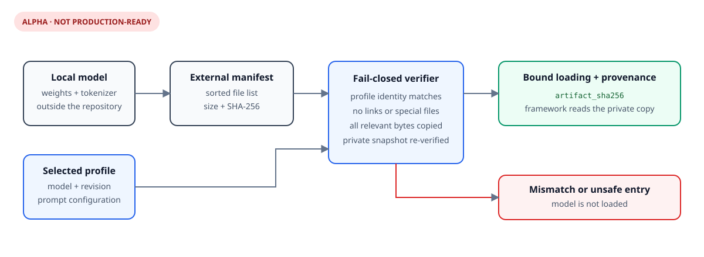

# Architecture

## Scope

The core is a model-independent boundary for bounded synthetic or
already-sanitized JSONL, NDJSON, TXT, LOG, and CSV batches. Optional adapters,
a CLI, and a localhost-only UI sit outside the core boundary and reuse the same
validation, orchestration, and atomic publication path.

## Components

| Component | Responsibility | Failure behavior |
|---|---|---|
| jsonl.py | Enforce optional byte/record limits, decode UTF-8, reject invalid JSON constructs, retain valid records, compute input identity | Reject a limit breach or collect validation issues and reject the whole batch |
| inputs.py | Select a supported format, preserve exact source identity, and validate text or CSV structure | Reject unsupported suffixes, malformed CSV, invalid UTF-8, or any limit breach before prediction |
| contracts.py | Validate stable input fields and predictor output mappings | Return line-specific issues or raise a predictor contract error |
| batch.py | Validate before prediction, chunk records, report staged progress, check cooperative cancellation, consume at most one excess output, enforce one output per input | Stop before publication if input, cancellation, or predictor behavior is invalid |
| atomic.py | Encode JSONL, apply permissions, sync a temporary file, publish, sync the directory | Attempt pre-publication temporary cleanup; distinguish committed failures |
| adapters/rules.py | Classify common log formats deterministically | Abstain when subsystem evidence is absent |
| adapters/zero_shot.py | Lazy-load a pinned NLI encoder, offline by default | Fail before publication on missing artifacts or invalid model output |
| model_profiles.py | Resolve versioned model, prompt, language, and taxonomy configurations | Reject unknown profiles before artifact loading |
| model_artifact.py | Create bounded SHA-256 inventories and private verified copies of local models | Reject identity drift, unsafe entries, concurrent changes, or any file mismatch before model import |
| application.py / cli.py | Expose shared local workflows | Return concise errors and non-zero CLI status |
| ui.py | Build an optional localhost Gradio interface | No launch or dependency import until explicitly requested |
| workspace.py | Persist versioned job states with local users, roles, sessions, retention, worker capabilities, and audit | Deny before prediction; apply state transitions and terminal results atomically |
| web/worker.py | Run a job-count and aggregate-byte-bounded, single-worker, in-memory queue behind a process lock | Keep raw bytes out of SQLite, cancel between chunks, and fail interrupted work without partial results |
| web/app.py / web/i18n.py / web/rate_limit.py | Provide an authenticated loopback API and localized server-rendered UI | Throttle failed login attempts, authenticate, authorize, check CSRF, validate catalogs, and enforce request limits before parsing uploads or invoking a predictor |

## Processing sequence

1. Read the input with an optional byte bound and calculate its SHA-256 digest.
2. Decode UTF-8 and select the parser from an explicit format or supported file
   suffix. JSONL/NDJSON reject duplicate keys and non-finite numbers; TXT/LOG
   map non-blank LF-delimited lines to messages; CSV enforces a unique header,
   exact `message` field, and fixed row shape.
3. Enforce an optional non-blank record-line bound and aggregate input issues.
   If a limit or validation issue occurs, reject the complete batch before
   invoking the predictor.
4. Call the predictor in bounded chunks and consume at most `chunk size + 1`
   results.
5. Require exactly one mapping with string keys for each input record.
6. Validate and encode each predictor chunk while staging a temporary file in
   the destination directory.
7. Flush, apply the requested mode, and sync the file; publish it without
   overwrite by default; then sync the parent directory.

For web workspace classification, authorization and complete input validation
occur before queue admission. SQLite receives a `queued` job plus only its
digest, counts, model name, state, and a hash of an internal worker capability;
the bearer token and source bytes are not persisted. One process-locked worker
claims the job, stages raw bytes in a private temporary directory, and updates
progress once per chunk. Logout does not revoke already accepted work.

Cancellation moves `queued` directly to `cancelled`, or `running` to
`cancelling` until the predictor returns to a chunk boundary. Results, exact
counts, terminal retention timestamp, and success audit event are committed in
one transaction only if completion wins the state-version race. Restart
recovery marks active jobs `failed/interrupted`; it never invents a retry
because raw queue bytes are intentionally not durable.

## Publication states

| State | Destination visible | Cleanup behavior | Caller signal |
|---|---:|---|---|
| Parsing/prediction failure | no | temporary file removed when possible; no destination published | validation or predictor exception |
| Temporary write failure | no | temporary file removed when possible | original exception |
| Publication failure | no | temporary file removed when possible | filesystem exception |
| Directory-sync failure | yes | destination is not falsely rolled back | PublicationDurabilityError |
| Temporary-link cleanup failure | yes | committed state is explicit | PublicationCleanupError |

## Trust boundaries

Input records and predictor output are untrusted. Structural validation does not
make arbitrary fields safe to store or disclose. The predictor runs in the
caller's process and is outside this library's security boundary. Destination
filesystem semantics are deployment assumptions that must be validated by an
integrator.

The local workspace database is one-organization-per-file. Every application
query is organization-scoped, but SQLite is not a host-level isolation boundary.
Database paths are opened without implicit creation after bootstrap, symlinks
and permissive files/directories are rejected, and unknown schemas fail before
DDL. These checks do not defend against the owning OS account or host root.

The web adapter is a separate optional boundary over the workspace service. It
binds to loopback in the CLI, does not trust proxy headers, allows no CORS
origins, and keeps API bearer authentication separate from UI cookie sessions.
It uses one bounded process-local queue, one predictor worker, and an exclusive
workspace lock file. A second instance cannot recover or execute the first
instance's active jobs. Polling reads a dedicated status projection and does
not append audit events. Login failures are bounded by account and direct-source
sliding windows whose keys are process-secret digests; the limiter is bounded,
shared by API and UI, and resets on restart. This is not a remote deployment
architecture.

## Model boundary

Model weights, tokenizers, caches, and datasets are external artifacts and must
not be committed. The default Hub adapter revision is immutable, remote
downloads are opt-in, remote code is disabled, and `safetensors` is required.
Local-directory model identity and revision must match a known profile. A
strict external manifest binds that identity to the size and SHA-256 digest of
every relevant file. At load time the adapter copies those files through
no-follow descriptors into a private temporary directory, verifies the copy,
and makes the framework load from that verified snapshot. Root `.cache` and
`.git` directories are excluded because they are operational metadata;
symbolic links, hard links, and special files elsewhere are rejected. Known
profiles bind model and revision, supported-language intent, candidate
descriptions, hypothesis templates, and truncation behavior. Each result
includes the verified artifact tree digest plus a deterministic configuration
digest covering that digest, the resolved per-head abstention thresholds, and
inference batch size. The adapter does not include the input message.

The manifest detects changes relative to the file inventory from which it was
created. It is not signed and does not prove that those original files came
from a trusted publisher; artifact acquisition and initial trust remain an
operator responsibility. The private snapshot prevents aliases outside the
model directory from changing the bytes between verification and framework
loading, but it does not defend against the owning OS account or host root.
Loading requires temporary free disk space approximately equal to the model and
removes the snapshot after tokenizer/model construction.

## Deliberate exclusions

The candidate contains no bundled model artifact, training code, dataset,
production log, deployment manifest, remotely exposed service, syslog listener,
infrastructure identifier, or secret-management integration.
